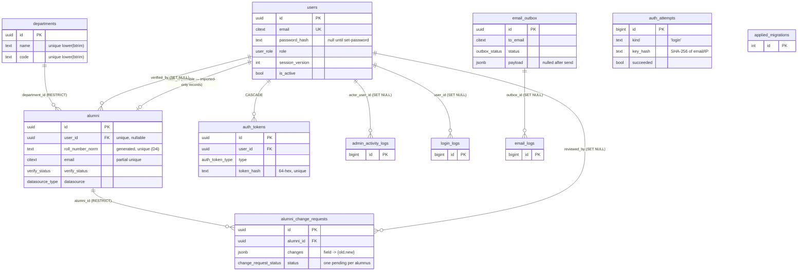

# Database schema (Prompt 2)

PostgreSQL 17, Supabase-hosted. Schema follows `context.md` §6 exactly —
11 tables, no deferred tables (`alumni_ecards`, content tables,
`import_batches`/`import_rows` arrive in their own phases).

## Entity-relationship diagram

## Per-table purpose

| Table                    | Purpose                                                                                                                                                                           |
| ------------------------ | --------------------------------------------------------------------------------------------------------------------------------------------------------------------------------- |
| `applied_migrations`     | Runner ledger: id, filename, SHA-256 checksum, applied_at, execution_ms. Bootstrap-created by the runner.                                                                         |
| `users`                  | ALL login identities — staff (superadmin/admin/viewer) and alumni. `session_version` invalidates JWTs on bump. `password_hash` stays NULL until the set-password flow (Prompt 3). |
| `departments`            | BS departments only. Normalised unique name+code. No seed rows (D3).                                                                                                              |
| `alumni`                 | The alumni data record. `user_id` nullable for imported-only records. `roll_number_norm` generated `lower(btrim(roll_number))`. Workflow fields per §6.                           |
| `alumni_change_requests` | Field change requests (`changes` = field → {old,new}). Max one pending per alumnus.                                                                                               |
| `auth_attempts`          | DB-backed login rate limiting. `key_hash` is SHA-256 hex of the normalised email or IP — raw values are never stored.                                                             |
| `auth_tokens`            | Hashed email-verification / password-reset tokens (single use, expiring).                                                                                                         |
| `email_outbox`           | Transactional email queue. `payload` may be nulled after send (one-time links must not linger).                                                                                   |
| `email_logs`             | Append-only delivery log (`status` is text so logs outlive enum changes).                                                                                                         |
| `admin_activity_logs`    | Append-only staff action log.                                                                                                                                                     |
| `login_logs`             | Append-only login attempt log.                                                                                                                                                    |
| `applied_migrations`     | see above                                                                                                                                                                         |

## Index rationale

Indexes exist only for predicates that are actually planned (§8 — the
dataset is small; space efficiency is a stated priority).

| Index                                                                 | Reason                                                                                                                                 |
| --------------------------------------------------------------------- | -------------------------------------------------------------------------------------------------------------------------------------- |
| `users_email_uniq`                                                    | Login + existence checks by email (citext → case-insensitive).                                                                         |
| `departments_name_lower_uniq`, `departments_code_lower_uniq`          | Normalised uniqueness for CRUD.                                                                                                        |
| `alumni_roll_number_norm_uniq`                                        | **D4 isolation** — the only place roll-number uniqueness lives; labelled in 0003. Registration existence check + import dedupe hit it. |
| `alumni_email_uniq` (partial, `email IS NOT NULL`)                    | Email uniqueness where present; NULLs repeat (imported records lack emails).                                                           |
| `alumni_department_id_idx`                                            | Admin list filter by department (also the FK for join predicates).                                                                     |
| `alumni_passing_year_idx`                                             | Admin list filter by passing year.                                                                                                     |
| `alumni_verify_status_created_idx`                                    | Admin tabs: `WHERE verify_status = ? ORDER BY created_at DESC` — serves list + counts at this scale.                                   |
| `alumni_change_requests_one_pending` (partial unique)                 | Enforces one pending request per alumnus.                                                                                              |
| `alumni_change_requests_status_created_idx`                           | Review queue: filter by status ordered by time.                                                                                        |
| `auth_attempts_lookup_idx`                                            | Rate-limit window read: `(kind, key_hash)` newest-first.                                                                               |
| `auth_tokens_user_type_idx`                                           | Token invalidation/lookup per user+type.                                                                                               |
| `email_outbox_retry_idx` (partial)                                    | Worker sweep: next-due `pending`/`failed` rows.                                                                                        |
| `admin_activity_logs_created_at_idx`, `admin_activity_logs_actor_idx` | Audit list ordering + per-actor view.                                                                                                  |
| `email_logs_created_at_idx`, `login_logs_created_at_idx`              | Audit list ordering.                                                                                                                   |

Deliberately NOT indexed (recorded here so nobody speculates): `city` —
the filter exists but at ~5k–20k rows a sequential scan is cheaper than
maintaining an index; add it later only if EXPLAIN shows it paying off at
real data size.

## Enums (native)

`user_role` (superadmin,admin,viewer,alumni) · `gender_type` (male,female,other)
· `verify_status` (under_approval,verified,rejected) · `datasource_type`
(registration,import) · `change_request_status` (pending,approved,rejected)
· `auth_token_type` (email_verification,password_reset) · `outbox_status`
(pending,sending,sent,failed).

Adding an enum value requires its own migration (`ALTER TYPE … ADD VALUE`
cannot run inside a transaction on Postgres < 12 and a new value cannot be
_used_ in the same transaction that adds it on any version).

## Integrity highlights

- `alumni`: `verified` ⇒ `verified_at` set; `rejected` ⇒ non-blank
  `reject_reason`; year ranges 1950–2100; session order; `degree='BS'`
  (named `alumni_degree_bs` for later relaxation); `bio ≤ 1000`;
  `social_links` must be a jsonb object.
- `auth_attempts.key_hash`, `auth_tokens.token_hash`: `^[0-9a-f]{64}$`
  (SHA-256 hex — raw values never stored).
- Audit tables: `prevent_audit_mutation()` trigger rejects UPDATE/DELETE
  for EVERYONE, including the migration owner.
- Every FK has an explicit `ON DELETE`: `RESTRICT` as default (departments
  with alumni can't be deleted), `SET NULL` for actor references
  (`verified_by`, `reviewed_by`, `actor_user_id`, `user_id` on logs,
  `outbox_id`, `alumni.user_id`), `CASCADE` only for `auth_tokens`.
